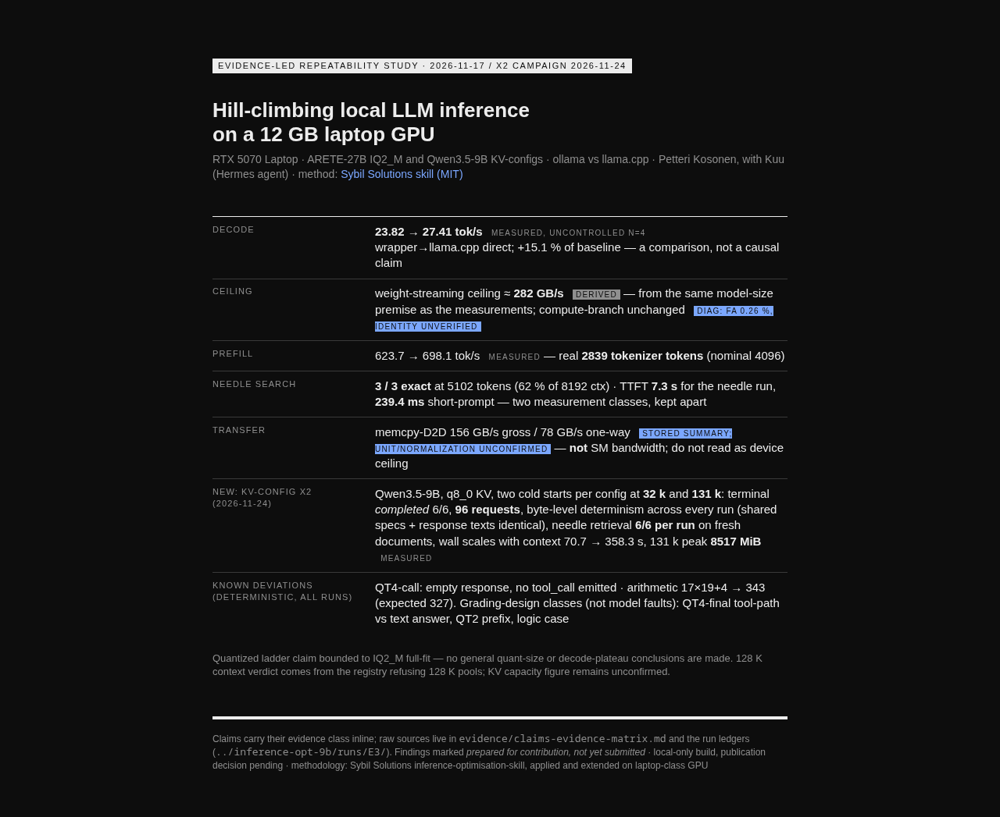

# Hill-climbing local LLM inference on a 12 GB laptop GPU
### 12 GB laptop GPU / ARETE-27B IQ2_M / ollama vs llama.cpp: an evidence-led repeatability study


## What a 12 GB laptop GPU can actually run

A **Qwen3.5-9B Q4_K_M** at **131 072 token context** is validated end-to-end on this
machine: **6/6 needles retrieved on all 3 cold starts** (fresh documents per cold start),
at a **peak of ~8.3 GiB (8.32 GiB, converted from `device_peak_observed_bytes`)**.

Cost of a 16-request series: **71 s @32k vs 358 s @131k**.

- Recipes: [`recipes-32k.json`](recipes-32k.json) / [`recipes-131k.json`](recipes-131k.json)
- Raw run results: [`evidence/run-results/`](evidence/run-results/)
- Analysis: [`ANALYSIS-LADDER-2026-11-24.md`](ANALYSIS-LADDER-2026-11-24.md)

## One working run command

Reproduce the validated 131k cold-start run with:

    /usr/bin/python3 -B evidence/p2a_live_launcher.py --go stage3-131k-c1

The launcher loads its substrate from `evidence/guarded_runtime.py` and
`evidence/execution-core.py`; the captured results for this run and its five
companions are stored alongside in `evidence/run-results/`.

For the full 6-ladder reproduction, use the apply plan that drove the 2026-11-24
campaign: [`evidence/run-plan.json`](evidence/run-plan.json). Run each ladder item
with the launcher's apply entrypoint:

    /usr/bin/python3 -B evidence/p2a_live_launcher.py --go <ladder-item>



Interactive version: open [`results/results-card-immersive.html`](results/results-card-immersive.html) in a browser.

## What this project is

A hill-climb feasibility study of local LLM serving speed on a **12 GB laptop dGPU**, following
the evidence methodology from the Sybil `inference-optimisation-skill`:

1. Compute the theoretical ceiling first (bandwidth-bound decode, compute-bound prefill).
2. Change one thing at a time, measure against interleaved controls (median-of-N).
3. Gate on long-context retrieval; log every experiment, including failures.
4. Qualify before claiming anything.

The goal was not "make tok/s bigger". The question the skill says must always precede tuning:
**what fraction of the hardware ceiling are we already at?**

## Results (measured on this machine, ledger in `evidence/ledger.jsonl`)

| Metric | ollama 0.40.15 (wrapper) | llama.cpp b12359 (direct) | Derived estimate (not an independent ceiling) |
|---|---|---|---|
| c1 decode (n=4) | 23.82 tok/s | **27.41 tok/s (+15.1% of baseline, uncontrolled n=4)** | ~282 GB/s SM-read (DERIVED from the same decode ×10.28 GB) |
| prefill 4096 (2839 real tokens) | 623.7 tok/s | **698.1 tok/s (+11.9% of baseline, uncontrolled n=4)** | 1265 tok/s (SPEC-derived practical ceiling, peak-TFLOPS UNMEASURED) |
| TTFT short | 260 ms | 239 ms | - |
| Long-context needle @5102 tok (62% ctx) | - | **3/3 exact**, TTFT 7.3 s | - |

Noise band with the direct server: **27.31-27.65 tok/s (<1.3% spread)** across the full protocol.

## Findings

### 1. The wrapper costs ~13-15 % -- an uncontrolled n=4 comparison, not a controlled win
The direct llama.cpp server (27.41 tok/s) and the ollama wrapper (23.82 tok/s) were measured at
n=4 with no paired controls, so the +15.1 % decode / +11.9 % prefill gap is an uncontrolled
comparison, not a causal wrapper win. The decode rate times 10.28 GB/token gives ~282 GB/s
effective read bandwidth — a value DERIVED from the same measured decode number, not an
independent ceiling (so "~100 % of the SM-read ceiling" is not proven by this evidence). Flag
tuning on top of `ollama` therefore cannot be shown to help or hurt from this evidence — the
wrapper/direct gap is an uncontrolled n=4 comparison (DIAGNOSTIC), not a causal result. The
observed difference is the engine layer itself, not a proven winning lever. A ceiling-first pass
took about 10 minutes and prevented an unbounded flag sweep.

### 2. `cudaMemcpy` D2D does not measure SM bandwidth
A memcpy-based bandwidth probe returned **156 GB/s gross (78 GB/s one-way)** — stored summary;
unit/normalization UNCONFIRMED (raw run log absent). The same GPU sustains ~282 GB/s of weight
streaming during decode — model-derived via the 10.28 GB/token premise, not a direct SM traffic
measurement. The copy runs on the copy engines (CE), not the SM read path. A memcpy probe is
**not** a ceiling oracle on this hardware. The honest SM-read number is derived from a measured
real workload (decode rate times bytes/token).

### 3. Flash Attention: near-identical speeds, identity unverified
FA on/off is within noise on this dense model (27.34 vs 27.41 tok/s; prefill 697.6 vs 698.1).
The FA-on candidate's identity is unverified (ledger `startup_s=0.0`), so the FA comparison is
DIAGNOSTIC, not a controlled rejection. Recorded as a rejected lever per the methodology.
Negative results are part of the ledger.

### 4. Context gate: registry policy refuses 128K pools (REPORT:9); KV capacity UNCONFIRMED
`llama.cpp` at 8192 context holds the full pipeline in 12 GB. The registry-format context gate
requires 128K-token pools. A dense 27B at 128K would need ~18.8 GB (weights + quantized KV) by
one dense-KV-layout estimate, but the KV layout is UNCONFIRMED (THEORY.md gives ~17-34 GB KV +
10.28 GB weights), so the exact "physically impossible 18.8 GB" figure is UNCONFIRMED, not an
established measurement. Documented as a diagnostic-class setup rather than a passing recipe,
with the next step identified: measured `peak-TFLOPS` plus a MoE/hybrid model class.

## Tooling

- `tools/bandwidth_probe.py` -- ctypes/cudart device-copy probe (source of finding 2)
- `tools/gguf_meta.py` -- minimal GGUF header reader (architecture verdict, 851 tensors / 48 kv)
- `evidence/` -- ledger, experiment plan (E0-E8), ceiling theory, configs
- `results/` -- static and interactive result cards (self-contained, no dependencies)

## Attribution

Methodology, gates, harness design and language adapted from
[Sybil Solutions' `inference-optimisation-skill`](https://github.com/sybil-solutions/inference-optimisation-skill)
(MIT). This project does not re-use their numbers; all measurements were taken on the hardware
named here. Their [`local-ai-registry`](https://github.com/sybil-solutions/local-ai-registry)
recipe concept (validated recipes with evidence attached) motivates the artifact format.

## Honest limits

- One GPU class, one model, one quant (ARETE-27B study). A study, not a survey.
- `peak-TFLOPS` for the prefill ceiling is spec-derived, not measured. The prefill achieved-throughput share is 49-55% of the 1265 tok/s SPEC estimate (UNMEASURED ceiling; matrix M12).
  That share is NOT remaining headroom; the actual prefill headroom remains UNOBSERVED until a GEMM probe runs.
- Speculative decoding was not tested end-to-end: `ollama` hides that lever, and the direct path
  would need a draft-model experiment (planned).
- The skill followed here was one day old at the time of first use. Its published result table
  was read, not replicated.

## 3b. Verify the claims on any machine (no GPU required)

The published run logs let you check every headline number yourself:

```
python3 tools/verify-claims.py
```

55 checks run against `evidence/run-results/` (the six cold-start logs committed
here): run statuses, the 96-request total, model + effective-config identity
pins (read straight from the published `recipes-*.json`), byte-level determinism
of the shared spec responses, 11/16 functional pass ×6, 6/6 needle retrieval on
fresh documents ×6, wall times per context, and the budget totals
(88/120 · 857.9/7200 · 44/312 · 429.822/5400). Exit code 1 if any claim fails.

The `--go` command above reproduces the full campaign on identical hardware;
this script needs only Python.

**Author:** Petteri "Petsku" Kosonen, with Kuu (Hermes agent)
**Date:** 2026-11-17
**Methodology source:** [inference-optimisation-skill](https://github.com/sybil-solutions/inference-optimisation-skill) (MIT) by Sybil Solutions, applied and extended on a laptop-class GPU with two new measurement findings prepared for contribution (bundle registry-sub-arete, not yet submitted).
